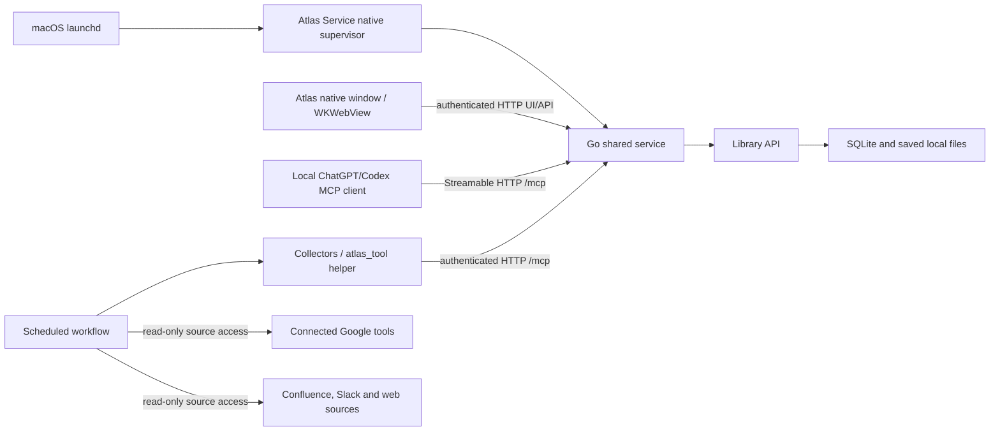

# Atlas architecture

The [application specification](specification.md) defines the current product behavior. Atlas uses one Go shared service for storage and application behavior. See [operations](operations.md) for setup, upgrades and recovery, and [scheduled tasks](../schedules/README.md) for source collection.

## One database owner, several clients

One Go process owns the production Library and its SQLite connection. The native supervisor starts/stops that child and supplies the macOS app identity used for Documents-folder permission. The supervisor itself does not open SQLite. The Atlas window is a separate client and can close without stopping the service.

HTTP UI/API requests and MCP calls serialize at the service boundary around the single owner connection. A per-library service lock prevents a second shared service from starting; Library retains its writer lock, transaction boundaries and revision checks. Unit tests can create separate temporary Libraries. Production clients must not instantiate Library or edit database/content files directly.

## Interfaces and authentication

The default service address is `http://127.0.0.1:47831`; a configured port is recorded with the library. The native window and clients read `library/.service/connection.json`, which contains the loopback address, library identity and private token. The directory and credential file have user-only permissions.

- UI and ordinary API routes share this service. The browser bootstraps an authenticated cookie; API requests also support authentication headers.
- MCP uses stateless Streamable HTTP at `/mcp`. Initialization, tool listing and tool calls return JSON. Notifications return 202. Standalone GET/SSE and DELETE are unsupported (405).
- MCP requires explicit authentication and enforces accepted hosts/origins. Loopback client requests bypass environment HTTP proxies.
- `scripts/atlas_tool.py <tool>` reads JSON arguments from stdin and calls the shared service. It does not load fresh backend code for each request; restart the service to load backend changes.
- Native clients and helpers use authenticated HTTP.

There is no public endpoint or tunnel. Cloud-only ChatGPT cannot reach this Mac’s loopback interface. The local desktop runtime and its connected tools provide the automation bridge.

Do not print, commit or share the token, connection file, credential-bearing UI URL, or private MCP configuration. The service’s startup log omits credentials. Local service authentication is separate from the Google/Slack account connections.

## Startup and lifecycle

The launch agent is `local.atlas.server`. It runs the bundled `AtlasService.app` native helper, which supervises `dist/Atlas.app/Contents/Resources/bin/atlas-service` with explicit owner/timezone. The launchd job label is separate from the signed helper bundle identifier. launchd starts it at login and restarts an exited job while loaded.

The installer creates the private connection settings and launch agent, starts the service, and checks health. `configure-mcp` checks health again before updating the existing `atlas` MCP registration and writing `library/.service/enabled`.

Native windows and HTTP helpers always require the service; they never construct a backend, including for a new unconfigured library. Repair service availability rather than starting another database owner to work around an outage.

Closing Atlas ends its UI process. Closing ChatGPT ends its scheduler/client availability. Neither action stops the activated launchd service. These are three separate lifecycles.

## Source intake and AI work

Atlas does not independently authenticate to external source systems or run a model. Connected desktop workflows supply read-only source access and summarization. Google Docs and Zoom use central intake; article and incident collectors use the feed interfaces described below.

Chrome and Zoom collectors submit eligible source identities/text through the shared service. Library checks canonical Google IDs, transcript hashes/legacy matches, queued work and tombstones. Only selected new sources proceed to Google content reads and AI summaries. The workflow sends complete originals and summaries to `complete_intake`; Library rechecks identity/deletion before committing.

The queue survives closed tabs and interrupted workflows. Up to five pending sources are processed per collection run. Duplicate and tombstoned sources do not become new items. An explicit human re-add restores the saved record; an automatic run cannot override a tombstone.

## Content refresh and owner enrichment

Content refresh uses metadata comparison, complete source reads, post-read metadata verification and text hashing. Changed content requires a new grounded summary. Only a verified successful refresh acknowledges a pending request. Earlier source snapshots and summary revisions remain preserved.

Owner repair uses metadata only. Google’s connector can expose ownership through individual permission entries with `role=owner` when `fields="*"` is requested. Missing permission information remains unresolved; it does not establish ownerlessness. Owner, creator, author, mentioned person and participant are distinct evidence-backed roles.

The hourly workflow asks Library for at most three due owner repairs. Persistent per-item/provider backoff controls retries. Activity records actual links/changes, not failed probes. The window’s background refresh is separate: it displays local changes without querying Google.

## Data model and reader

SQLite holds identities, search, revisions, source metadata, relationships, pending intake, ownership retry state, tombstones and Activity. People, Teams and Projects use `items.summary` as their authoritative database description. `entity_snapshots` preserves description revisions and historical originals; `entity_assets` preserves historical attachments. These entities need no item directories.

Documents and meetings retain per-item summary Markdown and full source snapshots. External Google Docs and Confluence pages keep their stable source keys and URLs; local snapshots support search and history without replacing the external originals. Zoom intake copies the complete queued transcript into Atlas before reporting success, so recording-folder files are independent.

At startup, after interrupted-write recovery and before readiness, Library migrates older entity files into SQLite and older shared source paths into per-item originals/attachments. Every copy is read back before references change or redundant entity files are removed. Existing item IDs, source hashes, links, organization and opaque history IDs remain valid. A conflict or missing source fails startup rather than discarding content. Remaining shared archives are safety copies, not active dependencies. Back up the database and content together.

People, Teams and Projects are entities with typed relationships. Topic/type tags remain separate; legacy typed tags are compatibility adapters. Confirmed authorship, attendance and document ownership retain their own records.

People’s right panel presents a deduplicated Owned / Authored list, then explicit Mentioned in documents and Meetings. This combines display rows without merging the underlying evidence or roles. Candidates remain under Interviews.

Clicking a document in a person/project/team collection, or a meeting in a person’s list, previews it in the center while the collection remains on the right and the originating profile stays selected in the left list. Navigation history includes that collection identity/material and scroll positions. Open in Documents or Open in Meetings deliberately switches to the corresponding full view; a profile link returns to the collection overview. Background updates refresh the retained collection rather than replacing it with document tags.

The right-hand panel stays mounted; unchanged markup is skipped and changed nodes are reconciled by identity. Scroll/focus survive same-context updates. Search uses lightweight database rows. Activity tracks successful changes broadly; Documents incorporates source-content update ordering and per-document seen cursors for all documents. Starred filters the list without changing monitoring cadence.

## Implementation map

| File | Responsibility |
| --- | --- |
| `app/Atlas.swift` | Native window and Go service supervisor |
| `service/cmd/atlas-service/`, `internal/transport/` | Active single-owner Go HTTP/API and MCP service |
| `service/internal/library/`, `internal/store/` | Active storage, identity, relationships, revisions and recovery |
| `app/service_client.py` | Private connection settings and HTTP-only tool calls |
| `scripts/service.py` | Documents access request, launch agent installation/lifecycle and local MCP configuration |
| `scripts/collect_sources.py` | Local source collection and service submission |
| `scripts/atlas_tool.py` | JSON-stdin service tool client |
| `web/app.js` | Browsing, stable context panel and local change display |
| `scripts/export_schedules.py` | Export actual task registrations; does not register or run jobs |

Installation selects the signed Go app plus explicit owner/timezone. Python is used for HTTP clients, collectors and build/test orchestration.

## Saved source and summary history

Authenticated read-only history routes expose saved content: GET /api/history/<item_id> lists opaque entry IDs for current/older originals and summaries; GET /api/history/<item_id>/<entry_id> reads exact saved bytes. Only known summary revisions are labeled. UUID source snapshots have no invented chronology. Trashed items are excluded. Paths and symlink components are rejected, and reads use descriptor-relative no-follow opens. These routes support source inspection and preservation checks.

## Native packaging

The installed service is deployed at `dist/Atlas.app`. The Go executable embeds its web assets, and only one service process may own a library at a time.

The active native supervisor accepts only `--go-service /absolute/path/to/atlas-service`, plus explicit library, port, owner name and timezone. It starts `--serve` directly and forwards termination. Tests may select guarded `--contract-mode`; no HTTP request can activate test controls.

`build-go.sh` assembles a separate preview with identifier `local.atlas.go-preview` and helper `local.atlas.go-preview.service`. It signs the embedded binary, helper and outer app with the configured reusable certificate, then verifies the bundle. It does not register the bundles or install a launch agent. Its `AtlasRequireService` property makes the native window fail closed when its service is missing; the native window always requires a configured shared service.

The native window library precedence is command-line `--library`, `ATLAS_LIBRARY`, then the current user's Documents/Atlas/library. Window configuration and packaging do not change connector registrations or scheduled tasks.

## Adaptive document monitoring

`document_monitor_state` holds the confirmed activity anchor and last successful content/metadata check. The local `list_google_documents(mode="due")` selector computes daily / every-other-day / weekly / 30-day / manual-only tiers at 3 / 14 / 60 / 180 days. Existing sources bootstrap from observed source timestamps, not repeated checks. Refresh requested bypasses every tier. Metadata-only/unchanged refreshes preserve the anchor; confirmed content changes reset it. Updates and monitor state commit with the refresh transaction. No external Google calls occur in Library. The hourly connector workflow processes due sources; the old morning Drive search is paused. Owner repair honors manual-only archival while keeping its own retry backoff for active documents.

## Feed attention
Feed entries retain independent items and dates. `feed_events` records first arrivals and meaningful in-place source changes; `feed_seen` stores a monotonic event cursor per feed. The legacy `feed_arrivals` table remains compatible, with a one-time migration preserving earlier event IDs and seen cursors. New events commit with their item mutation. `list_blog_feeds` and `get_blog_feed` expose `latest_entry_id` (an event cursor) and `unseen_entries` (distinct changed entries after the seen cursor), but never acknowledge them. The UI calls `mark_feed_seen(feed_id, through_id)` (`POST /api/feed-seen`) only after user navigation renders the entry or overview. A cursor must belong to that feed; a stale acknowledgement preserves newer changes. Trashed entries are excluded from attention counts. These cursors are separate from document update review and do not affect ordering. Background display updates never acknowledge them.

## Reusable feed workflows
Feed settings declare append/in_place update flow independently from entries/overview presentation and scheduler cadence. Legacy blog imports remain append producers. The generic configure_feed, upsert_feed_entry and record_feed_check operations let collectors submit structured source data; Library owns identity, tombstones, optimistic revisions, source/summary preservation, Activity and attention. feed_events extends arrival attention to meaningful in-place updates, with a one-time cursor-preserving migration from feed_arrivals. The overview UI derives sections and a stable keyed status/severity index from the same records. Source observation/coverage bookkeeping is separate from meaningful change detection. See [feed workflows](feed-workflows.md).
